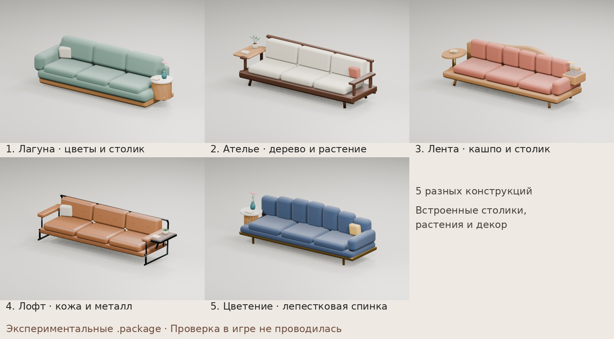
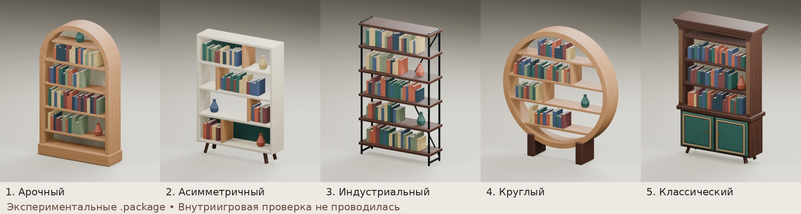

# Предметы для The Sims 4

## Пять диванов со встроенными столиками, растениями и декором

«Лагуна», «Ателье», «Лента», «Лофт» и «Цветение» — пять разных конструкций на основе трёхместного дивана.

**Экспериментальные сборки. Проверка в The Sims 4 не проводилась.**

[Скачать диваны: .package, .blend, 15 превью и отчёты](https://github.com/otekina98-source/sims4_kontent/raw/refs/heads/main/sofas_5_variants_experimental.zip)

[Подробное описание и ограничения](SOFAS_README_RU.md)

Для установки скопируйте только пять `.package` из папки `packages` архива в папку Mods. Встроенные столики и растения — часть модели; отдельные взаимодействия и слоты для них не создавались. Требования исходного шаблона GP05 сохранены.

## Пять книжных шкафов

Пять разных конструкций: арочная, асимметричная, индустриальная, круглая и классическая с нижними дверцами.

**Экспериментальные сборки. Внутриигровая проверка не проводилась. Полная работоспособность не подтверждена.**

[Скачать пять .package одним архивом](https://github.com/otekina98-source/sims4_kontent/raw/refs/heads/main/bookshelves_5_packages_experimental.zip)

## Установка

Распакуйте ZIP и поместите пять файлов `.package` в `Документы/Electronic Arts/The Sims 4/Mods`. Включите пользовательский контент в настройках игры и перезапустите её.

Названия в каталоге: «Аркада», «Композиция», «Мастерская», «Орбита», «Наследие».

В архив включены инструкция, отчёт о сборке и результаты технических проверок. Проверены структура DBPF, ресурсы, уникальность идентификаторов, геометрия, UV, ссылки на LOD, веса кости, декодирование текстур и таблицы строк. Работу взаимодействий и отображение в The Sims 4 необходимо проверить отдельно.
